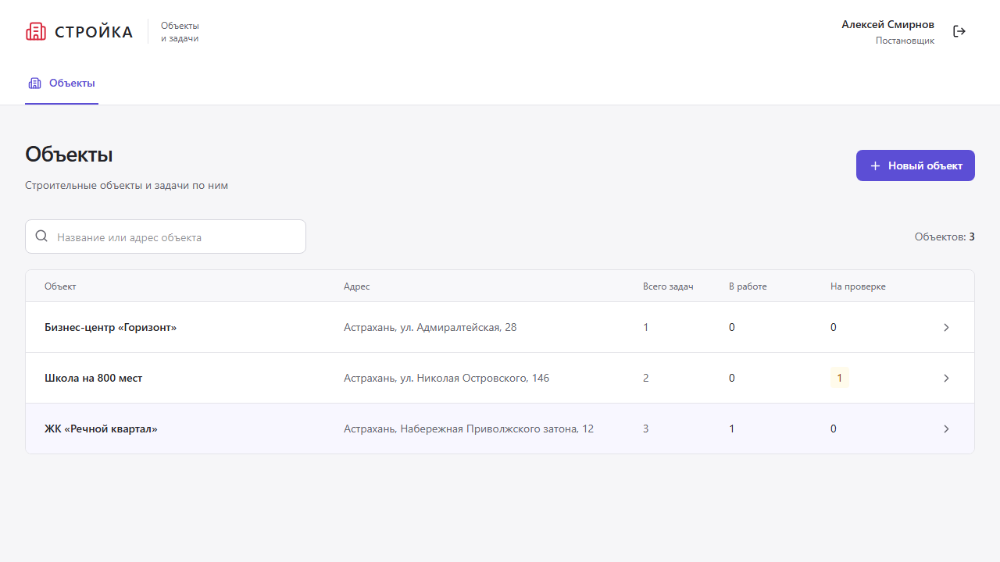

# Стройка — объекты и задачи

Мини-CRM по тестовому заданию: постановщики управляют объектами и задачами, исполнители видят только свою работу. React + TypeScript + Vite, Tailwind, компоненты в стиле shadcn/ui на Radix, TanStack Query, React Hook Form, Zod и Supabase.

[Открыть приложение](https://nastoiker.github.io/construction-crm-test/) · [Репозиторий](https://github.com/Nastoiker/construction-crm-test) · [CI](https://github.com/Nastoiker/construction-crm-test/actions/workflows/ci.yml)

## Запуск за несколько минут

Нужны Docker и актуальный **Node 22 LTS (22.22+) или Node 24**. На Node 22.17 обнаружен сбой загрузчика ESM в Playwright; CI использует актуальный Node 22.

```bash
npm ci
npx supabase start
node scripts/local-env.mjs
npm run seed
npm run dev
```

Приложение: http://127.0.0.1:5173. Supabase Studio: http://127.0.0.1:54323.

Скрипт создаёт случайные пароли для трёх локальных аккаунтов; доступы находятся в **`.env.e2e`** (файл не попадает в Git). Постановщик: `manager@crm.test`, исполнители: `alice@crm.test`, `bob@crm.test`. В базе три объекта и шесть задач во всех пяти статусах. Повторный seed обновляет доступы, сохраняет существующие объекты и не дублирует данные.

В PowerShell с запрещённым выполнением `.ps1` используйте `npm.cmd` / `npx.cmd`.

## Проверки

```bash
npm run check                 # ESLint, Prettier, TypeScript, build, unit, SQL security
npx playwright install chromium
npm run test:e2e              # настоящий локальный Supabase + Chromium + axe
npm audit --omit=dev
```

SQL-тесты работают без Docker на PGlite (PostgreSQL в WASM): проверяют RLS, все 50 сочетаний роли/перехода, прямые записи, подделку истории, конфликты версий. Playwright проверяет браузер и HTTP API реального Supabase. HTML-отчёт: `npx playwright show-report`; скриншоты успешных экранов — `artifacts/`.

## Архитектура и база

```text
src/app        провайдеры, маршруты, стили
src/pages      экраны приложения
src/widgets    оболочка, список задач
src/features   вход, формы, смена статуса
src/entities   задачи, объекты, сессия: модели и запросы
src/shared     типизированный Supabase-клиент, общие UI-компоненты
supabase/      миграция и конфигурация Auth
```

ESLint запрещает импорт из вышележащих FSD-слоёв. Срезы экспортируют публичный API через `index.ts`. Серверные данные хранятся в TanStack Query; формы — в React Hook Form. Типы базы сгенерированы из применённой миграции, ответы дополнительно проверяются Zod.

Роли API имеют только `SELECT` на таблицы с RLS. Записи — через узкие SQL-функции, которые заново проверяют пользователя, роль, версию и переход. История создаётся в той же транзакции. Подробнее: [решения и ограничения](docs/decisions.md).

## CI/CD и развёртывание

`.github/workflows/ci.yml`: линтеры, типы, сборка, unit/SQL-тесты, аудит production-зависимостей; отдельный job поднимает Supabase и запускает Playwright. При ошибке сохраняются trace и HTML-отчёт.

`.github/workflows/deploy.yml`: после успешного CI на `main` публикует именно проверенный commit: применяет миграции, отключает открытую регистрацию, собирает фронтенд и публикует GitHub Pages. При ручном запуске сначала выполняет полный CI. Деплой активируется после настройки:

| GitHub configuration | Значения                                                    |
| -------------------- | ----------------------------------------------------------- |
| Variables            | `SUPABASE_URL`, `SUPABASE_ANON_KEY`, `SUPABASE_PROJECT_REF` |
| Secrets              | `SUPABASE_ACCESS_TOKEN`, `SUPABASE_DB_PASSWORD`             |
| Pages                | Build and deployment → GitHub Actions                       |

`service_role` нужен только локальному административному seed-скрипту. Он не нужен сборке, браузеру и Pages. Для облачного seed скопируйте `.env.seed.example` в `.env.seed`, задайте уникальные пароли и выполните `npm run seed -- --remote`.

Альтернативный хостинг: `docker compose --env-file .env.local up --build -d`. Фронтенд с nginx доступен на порту 8080; параметры Supabase встраиваются при сборке. В production укажите публичный HTTPS URL Supabase и разместите nginx за HTTPS reverse proxy. `nginx.conf` поддерживает прямые переходы по маршрутам.

Материалы сдачи: [объяснение руководителю](docs/for-manager.md), [решения](docs/decisions.md), [dev review](docs/dev-review.md), [QA review](docs/qa-review.md).

Для проверки опубликованной версии задайте `E2E_BASE_URL` (с завершающим `/`) и `E2E_ENV_FILE` (путь к приватному файлу с `SUPABASE_URL`, `SUPABASE_ANON_KEY` и тестовыми аккаунтами), затем выполните `npm run test:e2e`. Тесты создают и удаляют собственные временные объекты и задачи. Пароли демо передаются отдельно.


